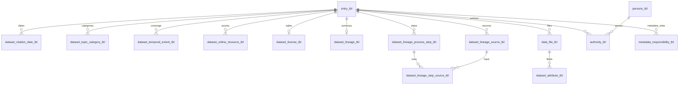

# DataPond table dictionary

Baseline snapshot: 2026-10-08 · Package 1.2.0.0000 · ISO crosswalk v3.2.2

Lineage entries updated 2026-10-19 for crosswalk v3.2.3; one migration-marker column has been added since the baseline inventory.

Crosswalk v4.0.0 adds `geographic_extent_name` and promotes
`metadata_creation_date` into the startup schema; the baseline totals below
remain historical.

The metadata review exchange (2026-10-21) adds the lazily created workflow table
`dataset_review_exchange_tbl`; the original baseline totals exclude it.

The [startup migration patch v1](startup-migration-v1-2026-10-21.md) adds internal
TEXT completion columns: `entry_tbl.legacy_citation_v1_migrated_at`,
`entry_tbl.legacy_wave2_v1_migrated_at`,
`organisation_tbl.legacy_party_v1_migrated_at`, and
`dataset_license_tbl.legacy_licensing_v1_migrated_at`. It reuses the existing lineage
marker. NULL means the component has not yet been checked/migrated for that row;
a timestamp means it completed. These values travel with portable records and
are not exported as ISO metadata. The temporal compatibility view now permits an
entry-field fallback only before that record's Wave 2 completion marker is set.

Baseline in the origin column refers to crosswalk v1.0.0.

This dictionary explains the purpose of every table and view in the current
repository, what one row represents, how it is populated, and where related
or overlapping values belong. Start with `entry_tbl` for a dataset record and
`dataset_citation_date_tbl` for the typed-date addition that prompted this guide.

The baseline startup schema contained **38 tables and one view, with 578 column entries**
across those objects. The column inventory below was inspected in a temporary
pond after `init_db()` and `ensure_entry_data_access_columns()`; no operational
pond was changed. Additional known `entry_tbl` fields are listed separately
because schema-driven saves add them dynamically. Existing ponds can contain
other historical/custom columns and may retain older constraint definitions.

As of 2026-10-21, generated Citation/About controls use `dataset_overview_schema()`
in `R/dataset_overview_schema.R`, shared with hydration, saving and validation.
The original workbook documents additional historical fields; it no longer drives
normal startup. No stored columns were removed in this cleanup. First-use party
seeding records `party_seed_initialised` in `app_config_tbl` at pond scope, with
`user_id = NULL` and value `packaged_csv` or `existing_catalogue`. Existing party
records and user permissions are not refreshed from packaged CSVs at startup.

## How to read the dictionary

- **Authoritative** means the value the current model intends to use for that
  concept. **Compatibility** means an older projection or retained text; it
  should not require duplicate user entry.
- **Derived** records come from scanning, profiling or aggregation. **Workflow**
  records describe app operations. Neither automatically establishes a measured
  data-quality assertion.
- **Declared FK** means SQLite has a foreign-key constraint. **Logical link**
  means application code maintains the relationship without such a constraint.
  A column ending in `_id` is not necessarily an enforced foreign key.
- `id` is normally a local integer row key. `dataset_id` normally refers to
  `entry_tbl.id`. Resource, metadata and pond UUIDs have different purposes;
  local numeric row IDs should not be used as portable identities.
- `_by_user_id` references an application account; `_by_person_id` references
  a shared person. Audit dates and people record who changed a value, not who
  authored or owns the underlying dataset.
- The column tables show declared SQLite types, keys, NOT NULL constraints and
  SQL defaults. A dash means no extra annotation, not that a field is required.
  SQL constraints do **not** equal app form obligations or ISO requirements.
  TEXT commonly stores date strings; Boolean flags commonly use INTEGER 0/1.
- Unique indexes are shown exactly where relevant. SQLite normally permits
  multiple NULL values in unique keys. Application validation can be stricter
  than the database, including same-dataset checks and controlled-code checks.
- Population expectations are described in the
  [Prickly Porcupine and Armoured Pangolin assessments](metadata-population-assessment.md).
  Prickly Porcupine is the lighter inventory target; Armoured Pangolin is the full target.
  One session-wide selector controls entry, draft saving, folder creation and
  status. It adds no database column or readiness assertion.
  A full record
  need not populate every specialist table. Crosswalk mappings remain
  implementation candidates; this dictionary does not assert ISO conformance.

## Relationship overview

This is a selected logical overview. The field inventories identify the actual
foreign keys; not all relationships or optional-party cardinalities are drawn.

## Tables at a glance

| Object | Purpose | Origin |
| --- | --- | --- |
| [`entry_tbl`](#entry_tbl) | Dataset identity and core description | Present in baseline; may have later extensions |
| [`data_pond_tbl`](#data_pond_tbl) | Pond identity and location | Present in baseline; may have later extensions |
| [`app_config_tbl`](#app_config_tbl) | Pond and user configuration | Present in baseline; may have later extensions |
| [`persons_tbl`](#persons_tbl) | Shared people directory | Present in baseline; may have later extensions |
| [`organisation_tbl`](#organisation_tbl) | Shared organisations and organisational hierarchy | Present in baseline; may have later extensions |
| [`user_tbl`](#user_tbl) | Application users and permissions | Present in baseline; may have later extensions |
| [`authority_tbl`](#authority_tbl) | Dataset author relationships | Present in baseline; may have later extensions |
| [`poc_tbl`](#poc_tbl) | Resource points of contact | Present in baseline; may have later extensions |
| [`dataset_organisation_tbl`](#dataset_organisation_tbl) | Dataset organisation roles | Present in baseline; may have later extensions |
| [`metadata_responsibility_tbl`](#metadata_responsibility_tbl) | Metadata record responsibilities | ISO Wave 1 |
| [`party_address_tbl`](#party_address_tbl) | Structured contact addresses | ISO Wave 3 |
| [`dataset_citation_date_tbl`](#dataset_citation_date_tbl) | Typed resource citation dates | ISO Wave 1 |
| [`dataset_topic_category_tbl`](#dataset_topic_category_tbl) | Controlled ISO topic categories | ISO Wave 1 |
| [`dataset_alternate_title_tbl`](#dataset_alternate_title_tbl) | Additional resource titles | ISO Wave 2 |
| [`keyword_vocab_tbl`](#keyword_vocab_tbl) | Selectable keyword vocabulary and approval state | Present in baseline; may have later extensions |
| [`keyword_thesaurus_tbl`](#keyword_thesaurus_tbl) | Citation for a keyword vocabulary | ISO Wave 3 |
| [`dataset_license_tbl`](#dataset_license_tbl) | Dataset sharing rights, licence and release conditions | Present in baseline; may have later extensions |
| [`license_template_tbl`](#license_template_tbl) | Reusable licence and sharing templates | Present in baseline; may have later extensions |
| [`dataset_online_resource_tbl`](#dataset_online_resource_tbl) | Online access locations | ISO Wave 2 |
| [`dataset_distribution_format_tbl`](#dataset_distribution_format_tbl) | Explicit distribution format specifications | ISO Wave 2 |
| [`dataset_temporal_extent_tbl`](#dataset_temporal_extent_tbl) | Temporal coverage of the resource | ISO Wave 2 |
| [`dataset_temporal_coverage_compat_vw`](#dataset_temporal_coverage_compat_vw) | Legacy temporal coverage projection | ISO Wave 2 |
| [`dataset_vertical_extent_tbl`](#dataset_vertical_extent_tbl) | Vertical coverage with a reference system | ISO Wave 3 |
| [`data_file_scan_tbl`](#data_file_scan_tbl) | File inventory scan runs | Present in baseline; may have later extensions |
| [`data_file_tbl`](#data_file_tbl) | Logical dataset file inventory | Present in baseline; may have later extensions |
| [`data_profile_run_tbl`](#data_profile_run_tbl) | Attribute and content profiling runs | Present in baseline; may have later extensions |
| [`dataset_attribute_tbl`](#dataset_attribute_tbl) | Field and raster dimension descriptions | Present in baseline; may have later extensions |
| [`dataset_feature_catalogue_tbl`](#dataset_feature_catalogue_tbl) | Feature catalogue identity and citation | ISO Wave 3 |
| [`data_file_spatial_metadata_tbl`](#data_file_spatial_metadata_tbl) | Extracted spatial metadata for files and layers | Present in baseline; may have later extensions |
| [`dataset_manual_spatial_extent_tbl`](#dataset_manual_spatial_extent_tbl) | Manually supplied spatial extents | Present in baseline; may have later extensions |
| [`dataset_spatial_summary_tbl`](#dataset_spatial_summary_tbl) | Derived dataset geographic bounds | Present in baseline; may have later extensions |
| [`supporting_document_tbl`](#supporting_document_tbl) | Supporting document inventory and inclusion decisions | Present in baseline; may have later extensions |
| [`dataset_lineage_tbl`](#dataset_lineage_tbl) | Overall lineage summary and workflow | Present in baseline; may have later extensions |
| [`dataset_lineage_source_tbl`](#dataset_lineage_source_tbl) | Ordered inputs and source citations | ISO Wave 1 |
| [`dataset_lineage_process_step_tbl`](#dataset_lineage_process_step_tbl) | Ordered production and transformation steps | ISO Wave 1 |
| [`dataset_lineage_step_source_tbl`](#dataset_lineage_step_source_tbl) | Links between process steps and their input sources | ISO Wave 1 |
| [`dataset_quality_result_tbl`](#dataset_quality_result_tbl) | Explicit evaluated data quality results | ISO Wave 2 |
| [`metadata_review_tbl`](#metadata_review_tbl) | Metadata editing and review history | Present in baseline; may have later extensions |
| [`dataset_import_tbl`](#dataset_import_tbl) | Imported dataset provenance | Present in baseline; may have later extensions |

## Values that should be entered once

| Concept | Authoritative location | Older or related location |
| --- | --- | --- |
| Publication event | `dataset_citation_date_tbl` | First publication date mirrors to `entry_tbl.citation_date` |
| Observation coverage | `dataset_temporal_extent_tbl` | First period mirrors to entry start/end and is exposed by the compatibility view |
| Access URL | `dataset_online_resource_tbl` | Primary resource mirrors to `entry_tbl.data_distribution_url` |
| Embargo and release | `dataset_license_tbl` | Older entry embargo fields remain compatibility values |
| Detailed source lineage | `dataset_lineage_source_tbl` | Old source text is migrated once; originals remain hidden snapshots |
| Detailed processing | `dataset_lineage_process_step_tbl` | Old process/tools/scripts/output text is migrated once; originals remain hidden snapshots |
| Theme keywords | `entry_tbl.keyword_object` | `keyword_topic` is merged as a legacy alias, not a second theme group |
| Dataset geographic bounds | `dataset_spatial_summary_tbl` | Native file/manual extents are inputs; legacy entry bbox is not another authoritative editor |
| Attribute descriptions | `dataset_attribute_tbl` | Feature catalogue content is generated from these rows |

Do not merge distinct meanings just because they share a data type: publication
and observation dates, resource and metadata contacts, and representative scale
and raster cell size are different facts. Additional operational restrictions
can supplement licence terms. Crosswalk v3.2.5 exports distinct notes alongside structured licences and removes whitespace-equivalent duplicates within each XML property (GAP-019 resolved for export); stored notes are unchanged.

## entry_tbl

**Dataset identity and core description.** One catalogue record per dataset/resource.

Created and edited by the main dataset form. This is the parent of dataset-linked tables. Resource identity and lifecycle live here; several older metadata fields are compatibility copies of normalized records.

`uuid` identifies the resource; `metadata_uuid` identifies its metadata record. `citation_key` is a generated citation identifier; `folder_key` is the readable folder component. `dataset_path` and `data_path` locate managed folders. `lifecycle_status`, `folder_locked`, hiding/deletion fields and release/archive fields govern workflow. `equivalent_scale_denominator` is a representative scale; `min_scale`/`max_scale` describe the separate creation/use scale extension. Scope, language and encoding have application defaults. See the dynamic-field inventory below for description fields not created at startup.

**Definition:** [db.R](../R/db.R#L354). **Origin:** Present in the baseline model; initialization applies later migrations.

The startup fields below include five access-module additions beyond `init_db()` alone: distributor organisation ID/text/other text, access constraints and use limitations. The workbook and main save path add further fields listed after this inventory.

| Field | SQLite type | Constraint, default or role |
| --- | --- | --- |
| `id` | INTEGER | Primary key |
| `uuid` | TEXT | — |
| `title` | TEXT | — |
| `citation_date` | TEXT | Compatibility mirror of the first structured publication date. |
| `version` | TEXT | — |
| `abstract` | TEXT | — |
| `data_pond_id` | TEXT | Logical link → `data_pond_tbl.data_pond_id` |
| `citation_key` | TEXT | — |
| `folder_key` | TEXT | — |
| `dataset_path` | TEXT | — |
| `data_path` | TEXT | — |
| `lifecycle_status` | TEXT | Default `'draft'` |
| `folder_locked` | INTEGER | Default `0` |
| `source_dataset_id` | INTEGER | Logical link → `entry_tbl.id` |
| `released_at` | TEXT | — |
| `released_by_person_id` | INTEGER | Logical link → `persons_tbl.id` |
| `archived_at` | TEXT | — |
| `archived_by_person_id` | INTEGER | Logical link → `persons_tbl.id` |
| `created_by_user_id` | INTEGER | Logical link → `user_tbl.id` |
| `is_hidden` | INTEGER | Default `0` |
| `hidden_at` | TEXT | — |
| `hidden_by_user_id` | INTEGER | Logical link → `user_tbl.id` |
| `deleted_at` | TEXT | — |
| `deleted_by_user_id` | INTEGER | Logical link → `user_tbl.id` |
| `equivalent_scale_denominator` | INTEGER | — |
| `max_scale` | INTEGER | — |
| `min_scale` | INTEGER | — |
| `creation_scale_note` | TEXT | — |
| `metadata_uuid` | TEXT | — |
| `metadata_resource_scope_code` | TEXT | Default `'dataset'` |
| `geographic_extent_name` | TEXT | Optional explicit area covered; an ISO geographic identifier alternative to coordinates. Not inferred from place keywords. |
| `metadata_creation_date` | TEXT | Actual UTC timestamp on first app save; historical precision retained. No migration/import backfill. Explicit initial-record events alone can supply export fallback. |
| `metadata_language_code` | TEXT | Default `'eng'` |
| `metadata_character_encoding` | TEXT | Default `'utf8'`; exported as IANA `UTF-8`. The UTF-8 XML publisher rejects a contradictory metadata encoding. |
| `data_distribution_url` | TEXT | Compatibility mirror of the primary online resource. |
| `embargo_status` | TEXT | Compatibility copy; authoritative rights are in dataset_license_tbl. |
| `embargo_reason` | TEXT | Compatibility copy of the embargo reason. |
| `embargo_end_date` | TEXT | Compatibility copy of the embargo end date. |
| `temporal_coverage_start_date` | TEXT | Compatibility copy of the first temporal extent start. |
| `temporal_coverage_end_date` | TEXT | Compatibility copy of the first temporal extent end. |
| `data_distributor_organisation_id` | INTEGER | Logical link → `organisation_tbl.id` |
| `data_distributor` | TEXT | Stored distributor display text; organisation identity uses data_distributor_organisation_id. |
| `data_distributor_other` | TEXT | — |
| `access_constraints` | TEXT | — |
| `use_limitations` | TEXT | — |

**Additional unique keys/indexes:** `(metadata_uuid)`; `(uuid)`.

### Additional entry fields from the active workbook and save path

These **15 workbook fields plus one code-managed field** are not present in the
fresh startup snapshot. `save_entry_dynamic()` adds fields supplied by a save,
normally as TEXT. An active workbook row does not guarantee a visible current
editor or that its column exists in an untouched pond. Several are deliberately
superseded by structured editors. The application also supports historical or
custom dynamic fields, so this list is the known current model rather than a
restriction on all possible SQLite columns.

| Field | Meaning and current authority |
| --- | --- |
| `citation` | Generated formatted citation; do not manually repeat the author/date/title data. |
| `dataset_credit` | Acknowledgement/credit text for use of the dataset. |
| `purpose` | Reason the dataset was created; distinct from its abstract. |
| `keyword_object` | Canonical selected theme/subject keywords; first value participates in citation-key generation. |
| `keyword_discipline` | Selected discipline/domain keywords. |
| `keyword_topic` | Legacy alias merged into keyword_object; no separate current theme editor. |
| `keyword_geo` | Selected geographic/place keywords. |
| `update_frequency` | Expected maintenance/update frequency. |
| `bbox` | Legacy geographic bounding-box text; prefer dataset_spatial_summary_tbl. |
| `data_complete_status` | Retained resource progress/completeness statement; excluded from required metadata checks and no longer part of the generated UI. This is not metadata-completion status. |
| `software_desc` | Legacy software used to develop the dataset; structured process references are preferred where applicable. |
| `cell_size` | Legacy grid-resolution text; detected raster resolution is stored in file spatial metadata. |
| `license_type` | Legacy licence selection; dataset_license_tbl is authoritative. |
| `epsg_code` | Legacy CRS code; use native file/manual spatial metadata for authority. |
| `scale_factor` | Legacy coordinate-to-ground scaling factor; not an equivalent-scale denominator. |
| `citation_author_type` | Added by the main save path; selects the citation-author style. It is not an extra author relationship. |

Sources: [current generated UI schema](../R/dataset_overview_schema.R), [historical workbook](../inst/extdata/metadata_schema.xlsx), [access fields](../R/utils_data_access.R), and [main save workflow](../R/zzz_app_main.R).

Since crosswalk v4.0.0, `metadata_creation_date` is a startup-schema field,
edited in Advanced metadata profile rather than a day-only generated input.
It describes creation of the metadata record, separate from resource publication
or observation dates. The export report retains the pinned DateTime-only rule
result alongside the declared DataPond policy accepting valid dates at their
recorded precision. An ordinary review is no longer a creation-date fallback.

## data_pond_tbl

**Pond identity and location.** One registered pond identity per row.

Populated by pond initialization and identity helpers. A stable pond identifier allows local records and imported provenance to distinguish ponds; the path is a location rather than the identity.

`data_pond_id` is the text primary key. `data_pond_path` is the local location, `data_pond_label` its display name, and `active` marks availability. A dataset links logically through `entry_tbl.data_pond_id`.

**Definition:** [db.R](../R/db.R#L5706). **Origin:** Present in the baseline model; initialization applies later migrations.

| Field | SQLite type | Constraint, default or role |
| --- | --- | --- |
| `data_pond_id` | TEXT | Primary key |
| `data_pond_path` | TEXT | — |
| `data_pond_label` | TEXT | — |
| `created_at` | TEXT | Default `CURRENT_TIMESTAMP`; Row audit timestamp |
| `updated_at` | TEXT | Default `CURRENT_TIMESTAMP`; Row audit timestamp |
| `created_by_user_id` | INTEGER | Logical link → `user_tbl.id` |
| `active` | INTEGER | Default `1` |

**Additional unique keys/indexes:** `(data_pond_id)`.

## app_config_tbl

**Pond and user configuration.** One configuration value for a pond/user/scope/key combination, subject to SQLite NULL uniqueness behavior.

Managed by the application. These settings are not dataset metadata and should not be presented as fields for a metadata editor to complete.

`config_scope` separates configuration scopes; `config_key` names a setting, `config_value` stores it, and `config_type` records its intended interpretation. `user_id` is an application-level link to `user_tbl`; only the pond relationship has a declared foreign key.

**Definition:** [db.R](../R/db.R#L5718). **Origin:** Present in the baseline model; initialization applies later migrations.

| Field | SQLite type | Constraint, default or role |
| --- | --- | --- |
| `id` | INTEGER | Primary key |
| `data_pond_id` | TEXT | NOT NULL; Declared FK → `data_pond_tbl.data_pond_id` |
| `user_id` | INTEGER | Logical link → `user_tbl.id` |
| `config_scope` | TEXT | NOT NULL; Default `'pond'` |
| `config_key` | TEXT | NOT NULL |
| `config_value` | TEXT | — |
| `config_type` | TEXT | Default `'text'` |
| `updated_at` | TEXT | Default `CURRENT_TIMESTAMP`; Row audit timestamp |

**Additional unique keys/indexes:** `(data_pond_id, user_id, config_scope, config_key)`.

## persons_tbl

**Shared people directory.** One saved person per row.

Edited through shared party management and reused by dataset authors, contacts, processors, metadata responsibilities and application users. Do not create another person just because the same individual has another role.

Name, email, phone and role title describe the person. `organisation_id` gives their organisation; dataset-specific responsibilities belong in the relationship tables. Nonblank email addresses have a normalized unique index.

**Definition:** [db.R](../R/db.R#L392). **Origin:** Present in the baseline model; initialization applies later migrations.

| Field | SQLite type | Constraint, default or role |
| --- | --- | --- |
| `id` | INTEGER | Primary key |
| `name_first` | TEXT | — |
| `name_last` | TEXT | — |
| `email` | TEXT | — |
| `role_title` | TEXT | — |
| `phone_number` | TEXT | — |
| `organisation_id` | INTEGER | Declared FK → `organisation_tbl.id` |

**Additional unique keys/indexes:** `(LOWER(TRIM(email))) WHERE email IS NOT NULL AND TRIM(email) != ''`.

## organisation_tbl

**Shared organisations and organisational hierarchy.** One organisation or organisational unit record per row.

Seeded and edited through party management. Used across resource ownership, authorship, distribution, rights, lineage and metadata contacts.

Full/short names and `organisation_code` support display and selection; the code is not unique. `parent_organisation_id` links a hierarchy at application level. `organisational_unit_name` is the structured unit name; `organisation_department` is retained and backfilled into it where missing. `organisation_address` retains free text while structured addresses live in `party_address_tbl`.

**Definition:** [db.R](../R/db.R#L365). **Origin:** Present in the baseline model; initialization applies later migrations.

| Field | SQLite type | Constraint, default or role |
| --- | --- | --- |
| `id` | INTEGER | Primary key |
| `organisation_name_full` | TEXT | — |
| `organisation_name_short` | TEXT | — |
| `organisation_code` | TEXT | NOT NULL |
| `organisation_department` | TEXT | — |
| `organisation_address` | TEXT | — |
| `parent_organisation_id` | INTEGER | Logical link → `organisation_tbl.id` |
| `organisational_unit_name` | TEXT | — |

## user_tbl

**Application users and permissions.** One application user per linked person; usernames and person links are unique.

Controls the active editor and administrative rights. A person may exist without an application account. A user account does not automatically establish dataset authorship.

`person_id` connects the account to the shared directory. `user_name` is the application name; `is_active` and `is_admin` govern access. Fields ending in `_user_id` elsewhere refer to accounts, not directly to people.

**Definition:** [db.R](../R/db.R#L423). **Origin:** Present in the baseline model; initialization applies later migrations.

| Field | SQLite type | Constraint, default or role |
| --- | --- | --- |
| `id` | INTEGER | Primary key |
| `person_id` | INTEGER | NOT NULL; Declared FK → `persons_tbl.id` |
| `user_name` | TEXT | — |
| `is_active` | INTEGER | Default `1` |
| `is_admin` | INTEGER | Default `0` |

**Additional unique keys/indexes:** `(user_name)`; `(person_id)`.

## authority_tbl

**Dataset author relationships.** One person-author relationship for a dataset per row; the schema does not declare a unique dataset/person pair.

Populated by the author editor and used in citation construction. Organisation-based citation choices use organisation relationships as well.

`person_id` selects an existing person, `author_order` controls citation order, and `role` describes their contribution. This table is not a permissions table despite its name.

**Definition:** [db.R](../R/db.R#L435). **Origin:** Present in the baseline model; initialization applies later migrations.

| Field | SQLite type | Constraint, default or role |
| --- | --- | --- |
| `id` | INTEGER | Primary key |
| `dataset_id` | INTEGER | Declared FK → `entry_tbl.id` |
| `person_id` | INTEGER | Declared FK → `persons_tbl.id` |
| `author_order` | INTEGER | Ordering within its parent/group |
| `role` | TEXT | — |

## poc_tbl

**Resource points of contact.** One dataset contact relationship per row.

Populated by the resource contact editor. Contacts can identify a person, an organisation, or both, as accepted by the app.

`dataset_id` identifies the resource being supported, while `person_id`, `organisation_id` and `role` identify the contact and responsibility. This is distinct from metadata-record contacts in `metadata_responsibility_tbl`.

**Definition:** [db.R](../R/db.R#L461). **Origin:** Present in the baseline model; initialization applies later migrations.

| Field | SQLite type | Constraint, default or role |
| --- | --- | --- |
| `id` | INTEGER | Primary key |
| `dataset_id` | INTEGER | Declared FK → `entry_tbl.id` |
| `person_id` | INTEGER | Declared FK → `persons_tbl.id` |
| `organisation_id` | INTEGER | Declared FK → `organisation_tbl.id` |
| `role` | TEXT | — |

## dataset_organisation_tbl

**Dataset organisation roles.** One dataset/organisation/normalized-role combination per row.

Edited in dataset organisation management. Reuses organisation identities for roles such as owner, custodian and citation-related responsibilities.

`role` is dataset-specific; it is not the organisation name or the person’s job title. The same organisation can hold several distinct roles. Distributor and rights-holder references elsewhere may reuse this organisation but are not automatically the same relationship.

**Definition:** [db.R](../R/db.R#L448). **Origin:** Present in the baseline model; initialization applies later migrations.

| Field | SQLite type | Constraint, default or role |
| --- | --- | --- |
| `id` | INTEGER | Primary key |
| `dataset_id` | INTEGER | Declared FK → `entry_tbl.id` |
| `organisation_id` | INTEGER | Declared FK → `organisation_tbl.id` |
| `role` | TEXT | — |

**Additional unique keys/indexes:** `( dataset_id, organisation_id, LOWER(TRIM(role)) )`.

## metadata_responsibility_tbl

**Metadata record responsibilities.** One dataset/person/organisation/role combination, with at most one primary row for each dataset and role.

Added in ISO Wave 1, Slice 1D, GAP-013. Stores explicit metadata creators, maintainers and contacts. The main save workflow supplies the active editor as a primary metadata contact when no explicit primary contact exists.

`role_code` accepts `creator`, `maintainer` or `pointOfContact`; `is_primary` selects the primary party for that role. Reuses existing people/organisations. Review history stays in `metadata_review_tbl` and is not converted into authorship.

**Definition:** [iso_profile_db.R](../R/iso_profile_db.R#L165). **Origin:** ISO Wave 1.

| Field | SQLite type | Constraint, default or role |
| --- | --- | --- |
| `id` | INTEGER | Primary key |
| `dataset_id` | INTEGER | NOT NULL; Declared FK → `entry_tbl.id` |
| `person_id` | INTEGER | Declared FK → `persons_tbl.id` |
| `organisation_id` | INTEGER | Declared FK → `organisation_tbl.id` |
| `role_code` | TEXT | NOT NULL |
| `is_primary` | INTEGER | NOT NULL; Default `0` |
| `created_at` | TEXT | NOT NULL; Default `CURRENT_TIMESTAMP`; Row audit timestamp |
| `created_by_person_id` | INTEGER | Declared FK → `persons_tbl.id` |
| `updated_at` | TEXT | NOT NULL; Default `CURRENT_TIMESTAMP`; Row audit timestamp |
| `updated_by_person_id` | INTEGER | Declared FK → `persons_tbl.id` |

**Additional unique keys/indexes:** `(dataset_id, role_code) WHERE is_primary = 1`; `( dataset_id, COALESCE(person_id, -1), COALESCE(organisation_id, -1), role_code )`.

**SQL CHECK rules:**

- `role_code IN ('creator', 'maintainer', 'pointOfContact')`

## party_address_tbl

**Structured contact addresses.** One address record for exactly one person OR one organisation.

Added in ISO Wave 3, GAP-016. Optional shared contact detail. Migration copies an existing organisation address verbatim into `delivery_point` only when that organisation has no address rows; it does not parse punctuation.

Address components, email, phone and online resource support detailed contact export. `is_primary` marks a preferred address; the database itself does not declare a unique primary-address index. Retain old free-text addresses until their content has been reconciled.

**Definition:** [iso_wave3_db.R](../R/iso_wave3_db.R#L121). **Origin:** ISO Wave 3.

| Field | SQLite type | Constraint, default or role |
| --- | --- | --- |
| `id` | INTEGER | Primary key |
| `person_id` | INTEGER | Declared FK → `persons_tbl.id` |
| `organisation_id` | INTEGER | Declared FK → `organisation_tbl.id` |
| `delivery_point` | TEXT | — |
| `city` | TEXT | — |
| `administrative_area` | TEXT | — |
| `postal_code` | TEXT | — |
| `country` | TEXT | — |
| `electronic_mail_address` | TEXT | — |
| `phone_number` | TEXT | — |
| `online_resource` | TEXT | — |
| `is_primary` | INTEGER | NOT NULL; Default `0` |
| `created_at` | TEXT | NOT NULL; Default `CURRENT_TIMESTAMP`; Row audit timestamp |
| `updated_at` | TEXT | NOT NULL; Default `CURRENT_TIMESTAMP`; Row audit timestamp |

**SQL CHECK rules:**

- `is_primary IN (0, 1)`
- `(person_id IS NOT NULL AND organisation_id IS NULL) OR (person_id IS NULL AND organisation_id IS NOT NULL)`

## dataset_citation_date_tbl

**Typed resource citation dates.** One date event per dataset per row; a dataset can have several events.

Added in ISO Wave 1, Slice 1C, GAP-005. Automatically created by `ensure_iso_profile_schema()` during initialization. Existing `entry_tbl.citation_date` values are backfilled as publication events when no publication row exists. The Citation editor supplies the primary publication date; the additional-date editor supplies other events.

`date_value` stores the date, `date_type_code` distinguishes creation/publication/revision, `date_precision` records year/month/day/dateTime, and `date_note` explains uncertainty or context. `sort_order` determines order; there is no `is_primary` field. The first publication row is mirrored back to `entry_tbl.citation_date`. These events describe the resource’s history, not the dates of its observations.

**Definition:** [iso_profile_db.R](../R/iso_profile_db.R#L142). **Origin:** ISO Wave 1.

| Field | SQLite type | Constraint, default or role |
| --- | --- | --- |
| `id` | INTEGER | Primary key |
| `dataset_id` | INTEGER | NOT NULL; Declared FK → `entry_tbl.id` |
| `date_value` | TEXT | NOT NULL; Resource event date; its meaning comes from date_type_code. |
| `date_type_code` | TEXT | NOT NULL; creation, publication or revision. |
| `date_precision` | TEXT | NOT NULL; Default `'day'`; year, month, day or dateTime; partial precision is retained. |
| `date_note` | TEXT | Optional context about this date. |
| `sort_order` | INTEGER | NOT NULL; Default `1`; Ordering within dataset; the first publication row is primary. |
| `created_at` | TEXT | NOT NULL; Default `CURRENT_TIMESTAMP`; Row audit timestamp |
| `created_by_person_id` | INTEGER | Declared FK → `persons_tbl.id` |
| `updated_at` | TEXT | NOT NULL; Default `CURRENT_TIMESTAMP`; Row audit timestamp |
| `updated_by_person_id` | INTEGER | Declared FK → `persons_tbl.id` |

**Additional unique keys/indexes:** `(dataset_id, sort_order)`.

**SQL CHECK rules:**

- `date_type_code IN ('creation', 'publication', 'revision')`
- `date_precision IN ('year', 'month', 'day', 'dateTime')`

### Worked example for citation dates

A dataset can carry these three rows:

| dataset_id | date_value | date_type_code | date_precision | sort_order |
| --- | --- | --- | --- | --- |
| 42 | 2021 | creation | year | 1 |
| 42 | 2022-06-15 | publication | day | 2 |
| 42 | 2024-03-01 | revision | day | 3 |

The compatibility field `entry_tbl.citation_date` is `2022-06-15`: the first
**publication** row, not simply the first row of any type. This is an
illustrative stored arrangement; the main app save path prepends its primary
publication date before additional dates. A survey covering 2018–2020 would
record that separate period in `dataset_temporal_extent_tbl`.

Users enter the main publication date once. Creation/revision events are
optional additional detail. A fresh migration creates the table even when
there are no additional dates. The table permits multiple events of the same
type; uniqueness applies to dataset/order, not dataset/date type. Stored
partial dates are supported, but the current export validator rejects year-
and month-precision citation dates, so storage capability is broader than
current export capability.

Creation/backfill and mirror synchronization are in
[iso_profile_db.R](../R/iso_profile_db.R); the editors are in
[mod_iso_profile.R](../R/mod_iso_profile.R). The originating requirement is
[Wave 1 Slice 1C](iso-metadata-gap-infill-plan.md#slice-1c-topic-categories-and-typed-dates).

## dataset_topic_category_tbl

**Controlled ISO topic categories.** One controlled topic category per dataset per row.

Added in ISO Wave 1, Slice 1C, GAP-004. Selected explicitly in the dataset intro. Used by the app’s scope-aware discovery checks.

`topic_category_code` is selected from the allowed category list; `sort_order` controls presentation. Do not infer it from free keywords. This table is distinct from the old `entry_tbl.keyword_topic` field, which is now a theme-keyword alias.

**Definition:** [iso_profile_db.R](../R/iso_profile_db.R#L112). **Origin:** ISO Wave 1.

| Field | SQLite type | Constraint, default or role |
| --- | --- | --- |
| `id` | INTEGER | Primary key |
| `dataset_id` | INTEGER | NOT NULL; Declared FK → `entry_tbl.id` |
| `topic_category_code` | TEXT | NOT NULL |
| `sort_order` | INTEGER | NOT NULL; Default `1`; Ordering within its parent/group |
| `created_at` | TEXT | NOT NULL; Default `CURRENT_TIMESTAMP`; Row audit timestamp |
| `created_by_person_id` | INTEGER | Declared FK → `persons_tbl.id` |
| `updated_at` | TEXT | NOT NULL; Default `CURRENT_TIMESTAMP`; Row audit timestamp |
| `updated_by_person_id` | INTEGER | Declared FK → `persons_tbl.id` |

**Additional unique keys/indexes:** `(dataset_id, sort_order)`; `(dataset_id, topic_category_code)`.

**SQL CHECK rules:**

- `topic_category_code IN ( 'farming', 'biota', 'boundaries', 'climatologyMeteorologyAtmosphere', 'economy', 'elevation', 'environment', 'geoscientificInformation', 'health', 'imageryBaseMapsEarthCover', 'intelligenceMilitary', 'inlandWaters', 'location', 'oceans', 'planningCadastre', 'society', 'structure', 'transportation', 'utilitiesCommunication' )`

## dataset_alternate_title_tbl

**Additional resource titles.** One alternate title per dataset per ordered row.

Added in ISO Wave 2, GAP-006. Optional entry of short, former, translated or other recognized names.

`alternate_title` complements the main `entry_tbl.title`; `title_type_code` records its kind, and `sort_order` orders titles. Do not repeat the main title just to populate this table.

**Definition:** [iso_wave2_db.R](../R/iso_wave2_db.R#L104). **Origin:** ISO Wave 2.

| Field | SQLite type | Constraint, default or role |
| --- | --- | --- |
| `id` | INTEGER | Primary key |
| `dataset_id` | INTEGER | NOT NULL; Declared FK → `entry_tbl.id` |
| `alternate_title` | TEXT | NOT NULL |
| `title_type_code` | TEXT | NOT NULL; Default `'alternate'` |
| `sort_order` | INTEGER | NOT NULL; Default `1`; Ordering within its parent/group |
| `created_at` | TEXT | NOT NULL; Default `CURRENT_TIMESTAMP`; Row audit timestamp |
| `created_by_person_id` | INTEGER | Declared FK → `persons_tbl.id` |
| `updated_at` | TEXT | NOT NULL; Default `CURRENT_TIMESTAMP`; Row audit timestamp |
| `updated_by_person_id` | INTEGER | Declared FK → `persons_tbl.id` |

**Additional unique keys/indexes:** `(dataset_id, sort_order)`.

## keyword_vocab_tbl

**Selectable keyword vocabulary and approval state.** One case-insensitive field/value combination per row.

Seeded from vocabulary resources and extended through keyword entry/administration. Stores the shared choices, not the list selected for a particular dataset; selections live in the dataset keyword fields.

`field_code` identifies the keyword group. `option_value` is the value and `option_label` its label. `source`, `approval_status` and `is_active` track governance. `thesaurus_id` is an application-maintained link to `keyword_thesaurus_tbl`; it is not a declared SQLite foreign key.

**Definition:** [db.R](../R/db.R#L26). **Origin:** Present in the baseline model; initialization applies later migrations.

| Field | SQLite type | Constraint, default or role |
| --- | --- | --- |
| `id` | INTEGER | Primary key |
| `field_code` | TEXT | NOT NULL |
| `option_value` | TEXT | NOT NULL |
| `option_label` | TEXT | — |
| `sort_order` | INTEGER | Ordering within its parent/group |
| `is_active` | INTEGER | NOT NULL; Default `1` |
| `source` | TEXT | NOT NULL; Default `'seed_csv'` |
| `approval_status` | TEXT | NOT NULL; Default `'approved'` |
| `created_at` | TEXT | Row audit timestamp |
| `created_by_user_id` | INTEGER | Logical link → `user_tbl.id` |
| `updated_at` | TEXT | Row audit timestamp |
| `updated_by_user_id` | INTEGER | Logical link → `user_tbl.id` |
| `thesaurus_id` | INTEGER | Logical link → `keyword_thesaurus_tbl.id` |

**Additional unique keys/indexes:** `( field_code COLLATE NOCASE, option_value COLLATE NOCASE )`.

## keyword_thesaurus_tbl

**Citation for a keyword vocabulary.** At most one thesaurus record per case-insensitive keyword field code.

Added in ISO Wave 3, GAP-014. Optional citation/version/URI detail for controlled keyword groups. The current schema models one thesaurus per keyword field, not an arbitrary number per field.

Citation title, edition/date, identifier, URI and responsible parties describe the vocabulary authority. These do not replace individual terms in `keyword_vocab_tbl` and should not be invented for free-text keywords.

**Definition:** [iso_wave3_db.R](../R/iso_wave3_db.R#L157). **Origin:** ISO Wave 3.

| Field | SQLite type | Constraint, default or role |
| --- | --- | --- |
| `id` | INTEGER | Primary key |
| `field_code` | TEXT | NOT NULL |
| `citation_title` | TEXT | NOT NULL |
| `edition` | TEXT | — |
| `edition_date` | TEXT | — |
| `edition_date_type_code` | TEXT | NOT NULL; Default `'revision'` |
| `thesaurus_uri` | TEXT | — |
| `identifier` | TEXT | — |
| `responsible_person_id` | INTEGER | Declared FK → `persons_tbl.id` |
| `responsible_organisation_id` | INTEGER | Declared FK → `organisation_tbl.id` |
| `responsible_role_code` | TEXT | NOT NULL; Default `'publisher'` |
| `created_at` | TEXT | NOT NULL; Default `CURRENT_TIMESTAMP`; Row audit timestamp |
| `updated_at` | TEXT | NOT NULL; Default `CURRENT_TIMESTAMP`; Row audit timestamp |

**Additional unique keys/indexes:** `(field_code)`.

## dataset_license_tbl

**Dataset sharing rights, licence and release conditions.** At most one rights record per dataset.

Authoritative structured rights model, extended by licensing v2 and ISO Wave 2 GAP-012. The sharing and distribution/embargo editors write different parts of this same row.

Licence template references and copied licence text identify the terms. `rights_basis_code`, holder, access, redistribution, permission reference, attribution and sensitivity fields record the sharing assessment. Embargo dates/reason and release audience/statement describe releasability. `rights_holder_organisation_id` is maintained by the app without a declared foreign key. Older `access_level`, `use_constraints` and `sensitive_data` coexist with the coded assessment fields; do not independently edit competing versions. Entry-level embargo values are compatibility mirrors.

**Definition:** [db.R](../R/db.R#L3035). **Origin:** Present in the baseline model; initialization applies later migrations.

| Field | SQLite type | Constraint, default or role |
| --- | --- | --- |
| `id` | INTEGER | Primary key |
| `dataset_id` | INTEGER | NOT NULL; Declared FK → `entry_tbl.id` |
| `license_template_id` | INTEGER | Declared FK → `license_template_tbl.id` |
| `license_identifier` | TEXT | — |
| `license_name` | TEXT | — |
| `license_description` | TEXT | — |
| `license_template_notes` | TEXT | — |
| `license_url` | TEXT | — |
| `license_holder` | TEXT | — |
| `access_level` | TEXT | — |
| `use_constraints` | TEXT | — |
| `sensitive_data` | INTEGER | — |
| `sensitivity_reason` | TEXT | — |
| `licence_notes` | TEXT | — |
| `updated_at` | TEXT | Row audit timestamp |
| `updated_by_person_id` | INTEGER | Declared FK → `persons_tbl.id` |
| `rights_basis_code` | TEXT | — |
| `rights_holder_organisation_id` | INTEGER | Logical link → `organisation_tbl.id` |
| `access_level_code` | TEXT | — |
| `redistribution_permission_code` | TEXT | — |
| `permission_reference` | TEXT | — |
| `required_attribution` | INTEGER | Default `0` |
| `attribution_text` | TEXT | — |
| `sensitivity_handling_code` | TEXT | — |
| `terms_review_date` | TEXT | — |
| `embargo_status` | TEXT | — |
| `embargo_reason` | TEXT | — |
| `embargo_start_date` | TEXT | — |
| `embargo_end_date` | TEXT | — |
| `release_addressee` | TEXT | — |
| `release_statement` | TEXT | — |
| `dissemination_constraint_code` | TEXT | — |

**Additional unique keys/indexes:** `(dataset_id)`.

## license_template_tbl

**Reusable licence and sharing templates.** One template per unique licence identifier.

Seeded/managed shared choices for the licensing editor. A template describes reusable terms; a dataset-specific rights decision belongs in `dataset_license_tbl`.

Name, description, notes and URL explain the terms. `ui_group`, `ui_label`, ordering and advanced/active flags control available choices. Linking a template does not by itself grant permission to distribute a dataset.

**Definition:** [db.R](../R/db.R#L3711). **Origin:** Present in the baseline model; initialization applies later migrations.

| Field | SQLite type | Constraint, default or role |
| --- | --- | --- |
| `id` | INTEGER | Primary key |
| `license_identifier` | TEXT | NOT NULL |
| `license_name` | TEXT | — |
| `description` | TEXT | — |
| `notes` | TEXT | — |
| `url` | TEXT | — |
| `ui_group` | TEXT | — |
| `ui_label` | TEXT | — |
| `sort_order` | INTEGER | Ordering within its parent/group |
| `is_advanced` | INTEGER | Default `0` |
| `is_active` | INTEGER | Default `1` |

**Additional unique keys/indexes:** `(license_identifier)`.

## dataset_online_resource_tbl

**Online access locations.** One ordered URL/URI resource per dataset per row; at most one primary row per dataset.

Added in ISO Wave 2, GAP-011. Entered in Online access. A legacy distribution URL is backfilled when structured resources are absent; structured saves mirror the primary resource to the older entry URL.

`resource_url` is the address. Name, description, protocol, function and media type qualify how it can be used. `is_primary` selects the primary resource. Multiple rows can represent download, information or other services; users enter each address once.

**Definition:** [iso_wave2_db.R](../R/iso_wave2_db.R#L125). **Origin:** ISO Wave 2.

| Field | SQLite type | Constraint, default or role |
| --- | --- | --- |
| `id` | INTEGER | Primary key |
| `dataset_id` | INTEGER | NOT NULL; Declared FK → `entry_tbl.id` |
| `resource_url` | TEXT | NOT NULL |
| `resource_name` | TEXT | — |
| `resource_description` | TEXT | — |
| `protocol` | TEXT | — |
| `function_code` | TEXT | NOT NULL; Default `'information'` |
| `media_type` | TEXT | — |
| `is_primary` | INTEGER | NOT NULL; Default `0` |
| `sort_order` | INTEGER | NOT NULL; Default `1`; Ordering within its parent/group |
| `created_at` | TEXT | NOT NULL; Default `CURRENT_TIMESTAMP`; Row audit timestamp |
| `created_by_person_id` | INTEGER | Declared FK → `persons_tbl.id` |
| `updated_at` | TEXT | NOT NULL; Default `CURRENT_TIMESTAMP`; Row audit timestamp |
| `updated_by_person_id` | INTEGER | Declared FK → `persons_tbl.id` |

**Additional unique keys/indexes:** `(dataset_id) WHERE is_primary = 1`; `(dataset_id, sort_order)`.

**SQL CHECK rules:**

- `function_code IN ( 'download', 'information', 'offlineAccess', 'order', 'search', 'completeMetadata', 'browseGraphic', 'upload', 'emailService', 'browsing', 'fileAccess' )`
- `is_primary IN (0, 1)`

## dataset_distribution_format_tbl

**Explicit distribution format specifications.** One ordered format specification per dataset per row.

Added in ISO Wave 2, GAP-011. Optional explicit distribution metadata used by the current ISO serializer.

`specification_title`, `format_version`, `media_type` and `format_uri` describe the format specification. File inventory format detection is stored separately. The current serializer does not automatically substitute detected file formats when this table is empty.

**Definition:** [iso_wave2_db.R](../R/iso_wave2_db.R#L159). **Origin:** ISO Wave 2.

| Field | SQLite type | Constraint, default or role |
| --- | --- | --- |
| `id` | INTEGER | Primary key |
| `dataset_id` | INTEGER | NOT NULL; Declared FK → `entry_tbl.id` |
| `specification_title` | TEXT | NOT NULL |
| `format_version` | TEXT | — |
| `media_type` | TEXT | — |
| `format_uri` | TEXT | — |
| `sort_order` | INTEGER | NOT NULL; Default `1`; Ordering within its parent/group |
| `created_at` | TEXT | NOT NULL; Default `CURRENT_TIMESTAMP`; Row audit timestamp |
| `created_by_person_id` | INTEGER | Declared FK → `persons_tbl.id` |
| `updated_at` | TEXT | NOT NULL; Default `CURRENT_TIMESTAMP`; Row audit timestamp |
| `updated_by_person_id` | INTEGER | Declared FK → `persons_tbl.id` |

**Additional unique keys/indexes:** `(dataset_id, sort_order)`.

## dataset_temporal_extent_tbl

**Temporal coverage of the resource.** One ordered coverage period per dataset per row.

Added in ISO Wave 2, GAP-017. Uses the temporal-extent editor; migration backfills the legacy start/end fields. Its first ordered period is mirrored into those entry fields for compatibility.

Start/end values and their precisions describe observation or phenomenon coverage. Indeterminate positions support unknown/ongoing endpoints; description and label explain the period. Multiple disjoint periods remain separate rows. These are not publication or revision dates.

**Definition:** [iso_wave2_db.R](../R/iso_wave2_db.R#L225). **Origin:** ISO Wave 2.

| Field | SQLite type | Constraint, default or role |
| --- | --- | --- |
| `id` | INTEGER | Primary key |
| `dataset_id` | INTEGER | NOT NULL; Declared FK → `entry_tbl.id` |
| `extent_label` | TEXT | — |
| `start_value` | TEXT | — |
| `end_value` | TEXT | — |
| `start_precision` | TEXT | NOT NULL; Default `'day'` |
| `end_precision` | TEXT | NOT NULL; Default `'day'` |
| `start_indeterminate` | TEXT | — |
| `end_indeterminate` | TEXT | — |
| `description` | TEXT | — |
| `sort_order` | INTEGER | NOT NULL; Default `1`; Ordering within its parent/group |
| `created_at` | TEXT | NOT NULL; Default `CURRENT_TIMESTAMP`; Row audit timestamp |
| `created_by_person_id` | INTEGER | Declared FK → `persons_tbl.id` |
| `updated_at` | TEXT | NOT NULL; Default `CURRENT_TIMESTAMP`; Row audit timestamp |
| `updated_by_person_id` | INTEGER | Declared FK → `persons_tbl.id` |

**Additional unique keys/indexes:** `(dataset_id, sort_order)`.

**SQL CHECK rules:**

- `start_precision IN ('year', 'month', 'day', 'dateTime')`
- `end_precision IN ('year', 'month', 'day', 'dateTime')`
- `start_indeterminate IN ('unknown', 'now', 'before', 'after') OR start_indeterminate IS NULL`
- `end_indeterminate IN ('unknown', 'now', 'before', 'after') OR end_indeterminate IS NULL`

## dataset_temporal_coverage_compat_vw

**Legacy temporal coverage projection.** One computed row per entry record; this is a VIEW, not stored metadata.

Added in ISO Wave 2. Exposes old start/end column names to readers that expect one period. Do not write to this view.

For each endpoint, the SQL uses the first structured extent value ordered by `sort_order, id`. The older entry value is a fallback only for an unmarked record awaiting the Wave 2 upgrade. After migration, a structured NULL or deliberate deletion remains NULL. The view does not compute the earliest/latest bounds across all periods.

**Definition:** [iso_wave2_db.R](../R/iso_wave2_db.R#L266). **Origin:** ISO Wave 2.

| Field | SQLite type | Constraint, default or role |
| --- | --- | --- |
| `dataset_id` | INTEGER | Logical link → `entry_tbl.id` |
| `temporal_coverage_start_date` | Expression (not declared) | — |
| `temporal_coverage_end_date` | Expression (not declared) | — |

## dataset_vertical_extent_tbl

**Vertical coverage with a reference system.** One ordered vertical range per dataset per row.

Added in ISO Wave 3, GAP-010. Specialist metadata only where vertical coverage is meaningful.

Minimum/maximum values must be ordered and accompanied by units and a vertical CRS name. URI/identifier fields make the unit and CRS more precise. `vertical_crs_type` distinguishes geoidal, depth, barometric or other references. Horizontal bounds and CRS remain in spatial metadata tables.

Crosswalk v3.3.3 preserves these values, label and note in the full ISO candidate.
Recognised EPSG codes are checked against the local PROJ database for a standalone
vertical CRS with matching units and height/depth axis direction; the definition
is included in the XML. Export does not convert the saved numbers. Custom CRS
references carry an unverified-compatibility warning; a name alone retains its
text but exports an unknown CRS nil reason. Arbitrary unit URIs are preserved
without remote verification. This adds no required fields to the capture form.

**Definition:** [iso_wave3_db.R](../R/iso_wave3_db.R#L181). **Origin:** ISO Wave 3.

| Field | SQLite type | Constraint, default or role |
| --- | --- | --- |
| `id` | INTEGER | Primary key |
| `dataset_id` | INTEGER | NOT NULL; Declared FK → `entry_tbl.id` |
| `extent_label` | TEXT | — |
| `minimum_value` | REAL | NOT NULL |
| `maximum_value` | REAL | NOT NULL |
| `unit_symbol` | TEXT | NOT NULL |
| `unit_uri` | TEXT | — |
| `vertical_crs_name` | TEXT | NOT NULL |
| `vertical_crs_identifier` | TEXT | — |
| `vertical_crs_uri` | TEXT | — |
| `vertical_crs_type` | TEXT | NOT NULL; Default `'geoidal'` |
| `description` | TEXT | — |
| `sort_order` | INTEGER | NOT NULL; Default `1`; Ordering within its parent/group |
| `created_at` | TEXT | NOT NULL; Default `CURRENT_TIMESTAMP`; Row audit timestamp |
| `created_by_person_id` | INTEGER | Declared FK → `persons_tbl.id` |
| `updated_at` | TEXT | NOT NULL; Default `CURRENT_TIMESTAMP`; Row audit timestamp |
| `updated_by_person_id` | INTEGER | Declared FK → `persons_tbl.id` |

**Additional unique keys/indexes:** `(dataset_id, sort_order)`.

**SQL CHECK rules:**

- `vertical_crs_type IN ('geoidal', 'depth', 'barometric', 'other')`
- `minimum_value <= maximum_value`

## data_file_scan_tbl

**File inventory scan runs.** One recorded dataset file scan per row.

Created by file scanning. Operational history rather than metadata that users should manually reproduce.

`data_dir` is the scanned directory; scan time/status, detected count and notes record the run outcome. `data_file_tbl.latest_scan_id` points to the relevant latest run for an inventory item.

**Definition:** [db.R](../R/db.R#L2846). **Origin:** Present in the baseline model; initialization applies later migrations.

| Field | SQLite type | Constraint, default or role |
| --- | --- | --- |
| `id` | INTEGER | Primary key |
| `dataset_id` | INTEGER | NOT NULL; Declared FK → `entry_tbl.id` |
| `data_dir` | TEXT | — |
| `scan_timestamp` | TEXT | — |
| `scan_status` | TEXT | — |
| `files_detected` | INTEGER | — |
| `notes` | TEXT | — |
| `data_pond_id` | TEXT | Logical link → `data_pond_tbl.data_pond_id` |

## data_file_tbl

**Logical dataset file inventory.** One logical inventory item per dataset and relative path.

Created/refreshed by scans, with user annotations and inclusion choices. Groups can represent multifile formats and containers as well as ordinary files.

Path/name/type/size/time fields describe the item. Container and group fields retain logical grouping and sidecars. `active`, first/last seen and missing-since fields track availability. Description/notes, primary selection and bbox/attribute-scan inclusion are user choices. Scan state is operational evidence, not an ISO quality result.

**Definition:** [db.R](../R/db.R#L2864). **Origin:** Present in the baseline model; initialization applies later migrations.

| Field | SQLite type | Constraint, default or role |
| --- | --- | --- |
| `id` | INTEGER | Primary key |
| `dataset_id` | INTEGER | NOT NULL; Declared FK → `entry_tbl.id` |
| `data_file_rel_path_full` | TEXT | NOT NULL |
| `file_name` | TEXT | — |
| `file_dir` | TEXT | — |
| `file_stem` | TEXT | — |
| `file_key` | TEXT | — |
| `file_path` | TEXT | — |
| `data_file_extension` | TEXT | — |
| `data_file_format` | TEXT | — |
| `file_role` | TEXT | — |
| `is_container` | INTEGER | — |
| `container_type` | TEXT | — |
| `group_family` | TEXT | — |
| `group_key` | TEXT | — |
| `primary_dataset` | INTEGER | — |
| `sidecar_count` | INTEGER | — |
| `sidecar_exts` | TEXT | — |
| `sidecar_summary` | TEXT | — |
| `file_size_kb` | REAL | — |
| `modified_time` | TEXT | — |
| `scan_status` | TEXT | — |
| `active` | INTEGER | — |
| `first_seen_at` | TEXT | — |
| `last_seen_at` | TEXT | — |
| `missing_since` | TEXT | — |
| `latest_scan_id` | INTEGER | Declared FK → `data_file_scan_tbl.id` |
| `data_file_description` | TEXT | — |
| `data_file_notes` | TEXT | — |
| `include_in_dataset_bbox` | INTEGER | — |
| `include_in_attribute_scan` | INTEGER | — |
| `user_selected_primary` | INTEGER | — |
| `data_pond_id` | TEXT | Logical link → `data_pond_tbl.data_pond_id` |
| `content_hint` | TEXT | — |
| `review_status` | TEXT | — |
| `profile_updated_at` | TEXT | — |
| `updated_by_user_id` | INTEGER | Logical link → `user_tbl.id` |

**Additional unique keys/indexes:** `(dataset_id, data_file_rel_path_full)`.

## data_profile_run_tbl

**Attribute and content profiling runs.** One profiling attempt for a dataset/file per row.

Created by profiling operations. Keeps execution status, messages and timing separate from the metadata produced by those operations.

`profile_type`, `profile_status` and `profile_message` describe the operation. File/dataset/pond IDs identify its context; start/completion times and user identify execution. Field-level results belong in `dataset_attribute_tbl`.

**Definition:** [db.R](../R/db.R#L5795). **Origin:** Present in the baseline model; initialization applies later migrations.

| Field | SQLite type | Constraint, default or role |
| --- | --- | --- |
| `id` | INTEGER | Primary key |
| `dataset_id` | INTEGER | NOT NULL; Declared FK → `entry_tbl.id` |
| `data_file_id` | INTEGER | Declared FK → `data_file_tbl.id` |
| `data_pond_id` | TEXT | Logical link → `data_pond_tbl.data_pond_id` |
| `profile_type` | TEXT | NOT NULL; Default `'attribute_table'` |
| `profile_status` | TEXT | Default `'pending'` |
| `profile_message` | TEXT | — |
| `profiled_by_user_id` | INTEGER | Logical link → `user_tbl.id` |
| `started_at` | TEXT | Default `CURRENT_TIMESTAMP` |
| `completed_at` | TEXT | — |

## dataset_attribute_tbl

**Field and raster dimension descriptions.** One dataset/relative-file-path/layer/field combination per row.

Populated by profiling and enriched by user descriptions and units. Vector and tabular rows provide the reusable content for feature catalogues; raster dimensions remain coverage information.

Field name/alias/type/order identify a field. Description, units and legend fields supply interpretation. Examples, counts, minimum and maximum summarize profiled content; they are not independently asserted quality measures. File path/name and layer retain source context alongside the file ID.

**Definition:** [db.R](../R/db.R#L5742). **Origin:** Present in the baseline model; initialization applies later migrations.

| Field | SQLite type | Constraint, default or role |
| --- | --- | --- |
| `id` | INTEGER | Primary key |
| `dataset_id` | INTEGER | NOT NULL; Declared FK → `entry_tbl.id` |
| `data_file_id` | INTEGER | Declared FK → `data_file_tbl.id` |
| `data_pond_id` | TEXT | Logical link → `data_pond_tbl.data_pond_id` |
| `data_file_rel_path_full` | TEXT | — |
| `data_file_name` | TEXT | — |
| `layer_name` | TEXT | — |
| `data_field_alias` | TEXT | — |
| `data_field_name` | TEXT | NOT NULL |
| `data_field_desc` | TEXT | — |
| `data_field_units` | TEXT | — |
| `legend_field` | INTEGER | Default `0` |
| `legend_field_notes` | TEXT | — |
| `attribute_type` | TEXT | — |
| `attribute_order` | INTEGER | — |
| `example_values` | TEXT | — |
| `value_count` | INTEGER | — |
| `missing_count` | INTEGER | — |
| `unique_count` | INTEGER | — |
| `min_value` | TEXT | — |
| `max_value` | TEXT | — |
| `profile_updated_at` | TEXT | — |
| `updated_at` | TEXT | Row audit timestamp |
| `updated_by_user_id` | INTEGER | Logical link → `user_tbl.id` |

**Additional unique keys/indexes:** `(dataset_id, data_file_rel_path_full, COALESCE(layer_name, ''), data_field_name)`.

## dataset_feature_catalogue_tbl

**Feature catalogue identity and citation.** At most one catalogue header per dataset, with a unique catalogue UUID.

Added in ISO Wave 3, GAP-015. Optional catalogue title/version/language/producer metadata; detailed feature/field content is generated from `dataset_attribute_tbl`.

Do not enter the attribute dictionary again here. `catalogue_uuid`, title, version/date and producer references identify and cite the generated catalogue. A stored header alone does not mean its generated XML has passed conformance validation.

**Definition:** [iso_wave3_db.R](../R/iso_wave3_db.R#L209). **Origin:** ISO Wave 3.

| Field | SQLite type | Constraint, default or role |
| --- | --- | --- |
| `id` | INTEGER | Primary key |
| `dataset_id` | INTEGER | NOT NULL; Declared FK → `entry_tbl.id` |
| `catalogue_uuid` | TEXT | NOT NULL |
| `title` | TEXT | NOT NULL |
| `version` | TEXT | — |
| `version_date` | TEXT | — |
| `language_code` | TEXT | NOT NULL; Default `'eng'` |
| `producer_person_id` | INTEGER | Declared FK → `persons_tbl.id` |
| `producer_organisation_id` | INTEGER | Declared FK → `organisation_tbl.id` |
| `created_at` | TEXT | NOT NULL; Default `CURRENT_TIMESTAMP`; Row audit timestamp |
| `created_by_person_id` | INTEGER | Logical link → `persons_tbl.id` |
| `updated_at` | TEXT | NOT NULL; Default `CURRENT_TIMESTAMP`; Row audit timestamp |
| `updated_by_person_id` | INTEGER | Logical link → `persons_tbl.id` |

**Additional unique keys/indexes:** `(catalogue_uuid)`; `(dataset_id)`.

## data_file_spatial_metadata_tbl

**Extracted spatial metadata for files and layers.** One dataset/relative-file-path/layer-key combination per row.

Generated by spatial extraction, with user notes and bbox inclusion choices. Authoritative source for detected native CRS and spatial representation.

Crosswalk v3.4.0 exports representations for included rows linked to active
files. Raster axis resolutions retain units from the recorded CRS; vector
feature counts become primitive counts only for simple geometry. Band counts
do not imply the number of grid axes. Unknown properties remain explicit;
this adds no population fields.

CRS code/name/input/status and native bbox/status retain spatial interpretation. Coordinate limits, geometry type/feature count and raster dimensions/resolution describe extracted content. `layer_key` identifies the layer consistently. Dataset-wide WGS84 bounds are derived separately; do not confuse native coordinate limits with longitude/latitude.

**Definition:** [db.R](../R/db.R#L6471). **Origin:** Present in the baseline model; initialization applies later migrations.

| Field | SQLite type | Constraint, default or role |
| --- | --- | --- |
| `id` | INTEGER | Primary key |
| `dataset_id` | INTEGER | NOT NULL; Declared FK → `entry_tbl.id` |
| `data_file_id` | INTEGER | Declared FK → `data_file_tbl.id` |
| `data_pond_id` | TEXT | Logical link → `data_pond_tbl.data_pond_id` |
| `data_file_rel_path_full` | TEXT | NOT NULL |
| `file_path` | TEXT | — |
| `layer_name` | TEXT | — |
| `layer_key` | TEXT | NOT NULL; Default `''` |
| `spatial_status` | TEXT | — |
| `spatial_type` | TEXT | — |
| `crs_auth_code` | TEXT | — |
| `crs_name` | TEXT | — |
| `crs_input` | TEXT | — |
| `crs_status` | TEXT | — |
| `bbox_native` | TEXT | — |
| `bbox_status` | TEXT | — |
| `xmin` | REAL | — |
| `ymin` | REAL | — |
| `xmax` | REAL | — |
| `ymax` | REAL | — |
| `include_in_dataset_bbox` | INTEGER | NOT NULL; Default `0` |
| `bbox_inclusion_updated_at` | TEXT | — |
| `bbox_inclusion_updated_by_user_id` | INTEGER | Logical link → `user_tbl.id` |
| `geometry_type` | TEXT | — |
| `feature_count` | INTEGER | — |
| `raster_nrow` | INTEGER | — |
| `raster_ncol` | INTEGER | — |
| `raster_nlyr` | INTEGER | — |
| `raster_res_x` | REAL | — |
| `raster_res_y` | REAL | — |
| `spatial_note` | TEXT | — |
| `extracted_at` | TEXT | — |
| `extracted_by_user_id` | INTEGER | Declared FK → `user_tbl.id` |
| `user_notes` | TEXT | — |
| `notes_updated_at` | TEXT | — |
| `notes_updated_by_user_id` | INTEGER | Logical link → `user_tbl.id` |

**Additional unique keys/indexes:** `( dataset_id, data_file_rel_path_full, layer_key )`.

## dataset_manual_spatial_extent_tbl

**Manually supplied spatial extents.** One manual extent definition per row; a dataset may have several.

Entered when an extent must be supplied or corrected independently of scanning. Can refer to a dataset or a particular file and contributes to derived dataset bounds when active and included.

`extent_scope`, label and `source_note` explain what the extent represents. CRS fields and native coordinate limits define it. Inclusion/active flags control contribution. This is an input source; the dataset spatial summary is the derived output.

ISO export includes the label, source note and CRS in the geographic extent
description only when the active, included extent is listed among the summary's
contributors. It does not manufacture a data-production lineage step.

**Definition:** [db.R](../R/db.R#L6606). **Origin:** Present in the baseline model; initialization applies later migrations.

| Field | SQLite type | Constraint, default or role |
| --- | --- | --- |
| `id` | INTEGER | Primary key |
| `dataset_id` | INTEGER | NOT NULL; Declared FK → `entry_tbl.id` |
| `data_file_id` | INTEGER | Declared FK → `data_file_tbl.id` |
| `extent_scope` | TEXT | NOT NULL; Default `'dataset'` |
| `extent_label` | TEXT | NOT NULL |
| `source_note` | TEXT | — |
| `crs_auth_code` | TEXT | — |
| `crs_name` | TEXT | — |
| `crs_input` | TEXT | NOT NULL |
| `bbox_native` | TEXT | NOT NULL |
| `bbox_status` | TEXT | NOT NULL |
| `xmin` | REAL | NOT NULL |
| `ymin` | REAL | NOT NULL |
| `xmax` | REAL | NOT NULL |
| `ymax` | REAL | NOT NULL |
| `include_in_dataset_bbox` | INTEGER | NOT NULL; Default `1` |
| `active` | INTEGER | NOT NULL; Default `1` |
| `created_at` | TEXT | Row audit timestamp |
| `created_by_user_id` | INTEGER | Declared FK → `user_tbl.id` |
| `updated_at` | TEXT | Row audit timestamp |
| `updated_by_user_id` | INTEGER | Declared FK → `user_tbl.id` |

## dataset_spatial_summary_tbl

**Derived dataset geographic bounds.** At most one generated spatial summary per dataset.

Recomputed from eligible included spatial sources. Authoritative dataset-level WGS84 discovery extent rather than another manually populated bbox.

`bbox_crs`, `bbox_wgs84` and limits describe the result. Status/message explain validity; included/eligible/skipped counts, contributor keys and derivation method explain its source. Regeneration should follow changed source extents or inclusion decisions.

The export preserves derivation method as a labelled extent description.
Contributor keys select the relevant manual notes; internal IDs themselves
are not exported. Legacy entry bounds cannot override any structured spatial
record, including an excluded source or an invalid summary.

**Definition:** [db.R](../R/db.R#L6749). **Origin:** Present in the baseline model; initialization applies later migrations.

| Field | SQLite type | Constraint, default or role |
| --- | --- | --- |
| `id` | INTEGER | Primary key |
| `dataset_id` | INTEGER | NOT NULL; Declared FK → `entry_tbl.id` |
| `bbox_status` | TEXT | NOT NULL; Default `'not_derived'` |
| `status_message` | TEXT | — |
| `bbox_crs` | TEXT | NOT NULL; Default `'EPSG:4326'` |
| `bbox_wgs84` | TEXT | — |
| `xmin` | REAL | — |
| `ymin` | REAL | — |
| `xmax` | REAL | — |
| `ymax` | REAL | — |
| `included_source_count` | INTEGER | NOT NULL; Default `0` |
| `eligible_source_count` | INTEGER | NOT NULL; Default `0` |
| `skipped_source_count` | INTEGER | NOT NULL; Default `0` |
| `contributor_keys` | TEXT | — |
| `derivation_method` | TEXT | — |
| `generated_at` | TEXT | — |
| `generated_by_user_id` | INTEGER | Declared FK → `user_tbl.id` |

**Additional unique keys/indexes:** `(dataset_id)`.

## supporting_document_tbl

**Supporting document inventory and inclusion decisions.** One document per dataset and relative document path.

Populated by scans and user classification/review. Records reports, methods, licence evidence, notebooks and other supporting materials.

Automatic and user document-type fields preserve classification origin. `include_in_lineage` and `include_in_metadata` control intended use; a document can be authoritative lineage without copying its entire contents. Active/seen/missing fields track availability; review/classification fields track decisions.

**Definition:** [db.R](../R/db.R#L4508). **Origin:** Present in the baseline model; initialization applies later migrations.

| Field | SQLite type | Constraint, default or role |
| --- | --- | --- |
| `id` | INTEGER | Primary key |
| `dataset_id` | INTEGER | NOT NULL; Declared FK → `entry_tbl.id` |
| `document_rel_path` | TEXT | NOT NULL |
| `document_name` | TEXT | — |
| `document_dir` | TEXT | — |
| `document_path` | TEXT | — |
| `document_extension` | TEXT | — |
| `document_type_auto_code` | TEXT | — |
| `document_type_code` | TEXT | — |
| `document_type_label` | TEXT | — |
| `document_type_auto_text` | TEXT | — |
| `document_type_user_set` | INTEGER | Default `0` |
| `document_type_user_text` | TEXT | — |
| `include_in_lineage` | INTEGER | — |
| `include_in_metadata` | INTEGER | — |
| `notes` | TEXT | — |
| `active` | INTEGER | — |
| `first_seen_at` | TEXT | — |
| `last_seen_at` | TEXT | — |
| `missing_since` | TEXT | — |
| `classified_at` | TEXT | — |
| `classified_by_person_id` | INTEGER | Declared FK → `persons_tbl.id` |
| `reviewed_at` | TEXT | — |
| `reviewed_by_person_id` | INTEGER | Declared FK → `persons_tbl.id` |

**Additional unique keys/indexes:** `(dataset_id, document_rel_path)`.

## dataset_lineage_tbl

**Overall lineage summary and workflow.** At most one lineage summary per dataset.

Edited in the lineage module. Authoritative for the short overall statement, authority mode and lineage workflow status.

`lineage_source_mode` selects form or supporting-document authority. `lineage_statement` is the concise narrative. Six flat source/process/tools/scripts/output fields are hidden archival snapshots. Unmatched text migrates once into provisional rows in the two child tables. Existing `lineage_notes` merge into the narrative once; the original notes remain archived. `legacy_lineage_migrated_at` prevents subsequent edits/deletions from reviving the old values, including after dataset transfer. No legacy controls or separate notes input remain.

**Definition:** [db.R](../R/db.R#L4922). **Origin:** Present in the baseline model; initialization applies later migrations.

| Field | SQLite type | Constraint, default or role |
| --- | --- | --- |
| `id` | INTEGER | Primary key |
| `dataset_id` | INTEGER | NOT NULL; Declared FK → `entry_tbl.id` |
| `lineage_source_mode` | TEXT | Default `'form'` |
| `lineage_statement` | TEXT | — |
| `source_description` | TEXT | Preserved legacy text; read-only in the current app. |
| `source_datasets_text` | TEXT | Preserved legacy text; read-only in the current app. |
| `process_description` | TEXT | Preserved legacy text; read-only in the current app. |
| `processing_tools` | TEXT | Preserved legacy text; read-only in the current app. |
| `processing_scripts` | TEXT | Preserved legacy text; read-only in the current app. |
| `output_description` | TEXT | Preserved legacy text; read-only in the current app. |
| `lineage_notes` | TEXT | Hidden pre-migration snapshot |
| `legacy_lineage_migrated_at` | TEXT | Local migration timestamp; not ISO metadata |
| `lineage_status` | TEXT | — |
| `updated_at` | TEXT | Row audit timestamp |
| `updated_by_person_id` | INTEGER | Declared FK → `persons_tbl.id` |

**Additional unique keys/indexes:** `(dataset_id)`.

## dataset_lineage_source_tbl

**Ordered inputs and source citations.** One ordered input/source record per dataset per row.

Added in ISO Wave 1, Slice 1A, GAP-008. Entered in the source editor or backfilled as one provisional record from legacy source text; migration does not split prose into guessed sources.

Title, identifier, description, URI and citation date describe an input resource. Temporal coverage and scale/resolution describe that source, not necessarily the resulting dataset. Responsible parties and an optional supporting-document link record authority. ISO export includes these parties and temporal scope; when both scale and distance are saved, scale is structured and distance is preserved as labelled source text because the target permits one resolution. `value_origin_code` and `is_provisional` distinguish entry/extraction/backfill context.

**Definition:** [db.R](../R/db.R#L4958). **Origin:** ISO Wave 1.

| Field | SQLite type | Constraint, default or role |
| --- | --- | --- |
| `id` | INTEGER | Primary key |
| `dataset_id` | INTEGER | NOT NULL; Declared FK → `entry_tbl.id` |
| `source_order` | INTEGER | NOT NULL; Default `1`; Ordering within its parent/group |
| `title` | TEXT | — |
| `identifier` | TEXT | — |
| `identifier_code_space` | TEXT | — |
| `description` | TEXT | — |
| `source_uri` | TEXT | — |
| `citation_date` | TEXT | Citation date of the input source, not of the output dataset. |
| `citation_date_type_code` | TEXT | — |
| `temporal_start` | TEXT | — |
| `temporal_end` | TEXT | — |
| `equivalent_scale_denominator` | INTEGER | — |
| `spatial_resolution_value` | REAL | — |
| `spatial_resolution_unit` | TEXT | — |
| `responsible_person_id` | INTEGER | Declared FK → `persons_tbl.id` |
| `responsible_organisation_id` | INTEGER | Declared FK → `organisation_tbl.id` |
| `role_code` | TEXT | — |
| `supporting_document_id` | INTEGER | Declared FK → `supporting_document_tbl.id` |
| `value_origin_code` | TEXT | NOT NULL; Default `'user'` |
| `is_provisional` | INTEGER | NOT NULL; Default `0`; Marks provisional detail, including legacy backfill. |
| `created_at` | TEXT | NOT NULL; Default `CURRENT_TIMESTAMP`; Row audit timestamp |
| `created_by_person_id` | INTEGER | Declared FK → `persons_tbl.id` |
| `updated_at` | TEXT | NOT NULL; Default `CURRENT_TIMESTAMP`; Row audit timestamp |
| `updated_by_person_id` | INTEGER | Declared FK → `persons_tbl.id` |

**Additional unique keys/indexes:** `(dataset_id, source_order)`.

## dataset_lineage_process_step_tbl

**Ordered production and transformation steps.** One ordered process step per dataset per row.

Added in ISO Wave 1, Slice 1A, GAP-008. Entered in the process editor or backfilled as one provisional step from legacy process text.

Description states what happened; rationale explains why. Time, processor, tools/software, scripts and outputs document execution. Source inputs are linked through `dataset_lineage_step_source_tbl`; do not repeat an input citation in each process narrative. ISO export includes the recorded processor and preserves source links within the document.

**Definition:** [db.R](../R/db.R#L4993). **Origin:** ISO Wave 1.

| Field | SQLite type | Constraint, default or role |
| --- | --- | --- |
| `id` | INTEGER | Primary key |
| `dataset_id` | INTEGER | NOT NULL; Declared FK → `entry_tbl.id` |
| `step_order` | INTEGER | NOT NULL; Default `1`; Ordering within its parent/group |
| `description` | TEXT | — |
| `rationale` | TEXT | — |
| `step_datetime` | TEXT | — |
| `processor_person_id` | INTEGER | Declared FK → `persons_tbl.id` |
| `processor_organisation_id` | INTEGER | Declared FK → `organisation_tbl.id` |
| `role_code` | TEXT | — |
| `tool_software_reference` | TEXT | — |
| `script_reference` | TEXT | — |
| `output_description` | TEXT | — |
| `value_origin_code` | TEXT | NOT NULL; Default `'user'` |
| `is_provisional` | INTEGER | NOT NULL; Default `0`; Marks provisional detail, including legacy backfill. |
| `created_at` | TEXT | NOT NULL; Default `CURRENT_TIMESTAMP`; Row audit timestamp |
| `created_by_person_id` | INTEGER | Declared FK → `persons_tbl.id` |
| `updated_at` | TEXT | NOT NULL; Default `CURRENT_TIMESTAMP`; Row audit timestamp |
| `updated_by_person_id` | INTEGER | Declared FK → `persons_tbl.id` |

**Additional unique keys/indexes:** `(dataset_id, step_order)`.

## dataset_lineage_step_source_tbl

**Links between process steps and their input sources.** One unique process-step/source pair per row.

Added in ISO Wave 1, Slice 1A, GAP-008. Populated when sources are selected for a process step. Implements a many-to-many relationship: a step can use several sources, and a source can feed several steps.

`process_step_id` and `source_id` join the two detail tables. `dataset_id` records ownership. Individual foreign keys do not themselves enforce that all linked rows share a dataset; application validation supplies that rule.

**Definition:** [db.R](../R/db.R#L5022). **Origin:** ISO Wave 1.

| Field | SQLite type | Constraint, default or role |
| --- | --- | --- |
| `id` | INTEGER | Primary key |
| `dataset_id` | INTEGER | NOT NULL; Declared FK → `entry_tbl.id` |
| `process_step_id` | INTEGER | NOT NULL; Declared FK → `dataset_lineage_process_step_tbl.id` |
| `source_id` | INTEGER | NOT NULL; Declared FK → `dataset_lineage_source_tbl.id` |
| `created_at` | TEXT | NOT NULL; Default `CURRENT_TIMESTAMP`; Row audit timestamp |
| `created_by_person_id` | INTEGER | Declared FK → `persons_tbl.id` |

**Additional unique keys/indexes:** `(process_step_id, source_id)`.

## dataset_quality_result_tbl

**Explicit evaluated data quality results.** One ordered quality assertion per dataset per row, optionally scoped to a file or attribute.

Added in ISO Wave 2, GAP-009. Optional evidence-based records entered through quality templates/editors. Never backfill this table merely from successful scans or profiling counts.

Scope identifies what was evaluated. Measure identifier/name/type and evaluation method/date identify the test. Quantitative results use value/unit; conformance results use specification/pass; descriptive results use explanation. `pass` is a nullable Boolean result, not scan success.

**Definition:** [iso_wave2_db.R](../R/iso_wave2_db.R#L182). **Origin:** ISO Wave 2.

| Field | SQLite type | Constraint, default or role |
| --- | --- | --- |
| `id` | INTEGER | Primary key |
| `dataset_id` | INTEGER | NOT NULL; Declared FK → `entry_tbl.id` |
| `scope_code` | TEXT | NOT NULL; Default `'dataset'` |
| `data_file_id` | INTEGER | Declared FK → `data_file_tbl.id` |
| `attribute_id` | INTEGER | Declared FK → `dataset_attribute_tbl.id` |
| `measure_identifier` | TEXT | NOT NULL |
| `measure_name` | TEXT | — |
| `measure_type_code` | TEXT | NOT NULL; Broad category derived from a precise selection, retained for compatibility. |
| `quality_element_code` | TEXT | Nullable precise ISO quality test selected in the existing Measure type control; required for quality XML export, not draft saving. |
| `evaluation_method` | TEXT | NOT NULL |
| `evaluation_date` | TEXT | Recorded year/month/day or full timestamp. Export preserves precision; partial dates remain labelled evaluation text. |
| `result_type_code` | TEXT | NOT NULL |
| `result_value` | TEXT | — |
| `result_unit` | TEXT | — |
| `conformance_specification` | TEXT | — |
| `explanation` | TEXT | — |
| `pass` | INTEGER | Conformance outcome: 1 pass, 0 fail, NULL unspecified. |
| `sort_order` | INTEGER | NOT NULL; Default `1`; Ordering within its parent/group |
| `created_at` | TEXT | NOT NULL; Default `CURRENT_TIMESTAMP`; Row audit timestamp |
| `created_by_person_id` | INTEGER | Declared FK → `persons_tbl.id` |
| `updated_at` | TEXT | NOT NULL; Default `CURRENT_TIMESTAMP`; Row audit timestamp |
| `updated_by_person_id` | INTEGER | Declared FK → `persons_tbl.id` |

**Additional unique keys/indexes:** `(dataset_id, sort_order)`.

**SQL CHECK rules:**

- `scope_code IN ( 'dataset', 'series', 'service', 'software', 'model', 'nonGeographicDataset', 'featureType', 'attribute' )`
- `measure_type_code IN ( 'completeness', 'logicalConsistency', 'positionalAccuracy', 'thematicAccuracy', 'temporalQuality' )`
- `result_type_code IN ( 'quantitative', 'conformance', 'descriptive' )`
- `pass IN (0, 1) OR pass IS NULL`

## metadata_review_tbl

**Metadata editing and review history.** One review or update event per dataset per row.

Appended by metadata save/review workflows. Historical audit evidence; not the current metadata responsibility assignment.

Review time/date, reviewer, update type/reason/summary, section and status describe the event. `reviewer_id` refers to `persons_tbl`, not `user_tbl`. Saved name/role retain event context alongside that ID; app version and change source describe the workflow.

Crosswalk v3.3.2 exports review dates, reviewer contacts, affected section labels,
update reasons and summaries under metadata maintenance. Generic `notes`, update
types, workflow status, app version and change source remain local. Descriptive
reasons/summaries are export-facing; arbitrary prose is not automatically screened
for internal fragments. The linked person takes precedence over the saved name;
the full saved name is used only when no person is linked. A blank timestamp may
fall back to `review_date` without inventing a time. Past reviews do not establish
a review schedule: the exported metadata maintenance frequency is `unknown`.

**Definition:** [db.R](../R/db.R#L3486). **Origin:** Present in the baseline model; initialization applies later migrations.

| Field | SQLite type | Constraint, default or role |
| --- | --- | --- |
| `id` | INTEGER | Primary key |
| `dataset_id` | INTEGER | NOT NULL; Declared FK → `entry_tbl.id` |
| `review_timestamp` | TEXT | NOT NULL |
| `review_date` | TEXT | — |
| `reviewer_id` | INTEGER | Declared FK → `persons_tbl.id`; Reviewer person ID, not application user ID. |
| `reviewer_name` | TEXT | — |
| `reviewer_role` | TEXT | — |
| `update_type` | TEXT | — |
| `update_reason` | TEXT | — |
| `update_summary` | TEXT | — |
| `metadata_section` | TEXT | — |
| `metadata_status` | TEXT | — |
| `source_of_change` | TEXT | — |
| `app_version` | TEXT | — |
| `notes` | TEXT | — |

## dataset_import_tbl

**Imported dataset provenance.** One unique imported bundle identifier per row, linked to the local dataset.

Created by dataset transfer/import. Keeps source identity and export/import evidence while local numeric IDs are remapped.

The imported resource keeps its original UUID. These rows are transfer audit,
not upstream source datasets or production steps. Crosswalk v3.4.0 explicitly
keeps them local; the resource UUID is already exported in its citation.

Source dataset/pond IDs, source creator/exporter identifiers and names belong to the source pond and are not local foreign keys. Bundle version, folder/archive name and export/import times describe the transfer. `dataset_id` and `imported_by_user_id` point to local records.

**Definition:** [db.R](../R/db.R#L625). **Origin:** Present in the baseline model; initialization applies later migrations.

| Field | SQLite type | Constraint, default or role |
| --- | --- | --- |
| `id` | INTEGER | Primary key |
| `dataset_id` | INTEGER | NOT NULL; Declared FK → `entry_tbl.id` |
| `source_dataset_uuid` | TEXT | NOT NULL |
| `source_dataset_id` | INTEGER | — |
| `source_data_pond_id` | TEXT | NOT NULL |
| `source_created_by_user_id` | INTEGER | — |
| `source_created_by_user_name` | TEXT | — |
| `source_exported_by_user_id` | INTEGER | — |
| `source_exported_by_user_name` | TEXT | — |
| `bundle_id` | TEXT | NOT NULL |
| `bundle_format_version` | INTEGER | NOT NULL |
| `source_dataset_folder` | TEXT | — |
| `archive_name` | TEXT | — |
| `exported_at` | TEXT | — |
| `imported_at` | TEXT | Default `CURRENT_TIMESTAMP` |
| `imported_by_user_id` | INTEGER | Declared FK → `user_tbl.id` |

**Additional unique keys/indexes:** `(bundle_id)`.

## Maintaining this dictionary

The authoritative implementation is the initialization/migration code, including
[R/db.R](../R/db.R), [ISO profile persistence](../R/iso_profile_db.R),
[Wave 2 persistence](../R/iso_wave2_db.R), [Wave 3 persistence](../R/iso_wave3_db.R),
[access fields](../R/utils_data_access.R) and the dynamic schema/save workflow.
The [crosswalk](../inst/extdata/iso_crosswalk/README.md) describes intended ISO
mappings and precedence; it is not the SQL schema or proof of export coverage.

To refresh the physical inventory, initialize a temporary pond with
`init_db()` followed by `ensure_entry_data_access_columns()`. Inspect
`sqlite_master`, `PRAGMA table_info`, `PRAGMA foreign_key_list`,
`PRAGMA index_list` and `PRAGMA index_info`. Compare active workbook rows and
code-managed dynamic fields separately. Update purpose, field ownership and
migration notes whenever schema or editor behavior changes.

Verification for this snapshot checked that every one of the 39 objects and
all 578 startup table/view column entries appear in its own dictionary section,
that the additional 16 workbook fields are listed, and that local source links
resolve. This is schema-documentation verification; it does not run migrations
on operational ponds or certify an ISO document.

## dataset_review_exchange_tbl

One row per issued or received metadata review request. Created on first use of
the review exchange. Local workflow state; it adds no ISO metadata requirement.

| Columns | Purpose |
| --- | --- |
| `review_id` | Portable primary request UUID. |
| `dataset_id`, `dataset_uuid` | Local dataset link and stable resource identity. |
| `role`, `status` | Master/reviewer role and issued, working, accepted or cancelled state. |
| `master_pond_id`, `request_bundle_id`, `returned_bundle_id` | Origin and exact request/accepted-return provenance. |
| `baseline_hash`, `files_hash` | SHA-256 fingerprints used to reject stale returns. |
| `assignee`, `issued_at`, `issued_by_user_id` | Responsible colleague and issue event. |
| `accepted_by_user_id`, `accepted_at`, `decision_note` | Curator acceptance or cancellation explanation. |

The dataset/user links are logical links. This operational table is excluded
from ordinary dataset transfer payloads: requests explicitly establish the
reviewer's working context. Metadata review history and cumulative import
history remain in `metadata_review_tbl` and `dataset_import_tbl`. Private
baselines and previous accepted metadata snapshots are files under the pond's
`.metadata_pond/reviews` directory. See [review exchange](bundle-review-workflow.md).
